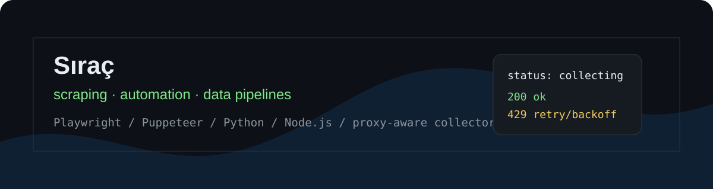

### Sıraç · Istanbul

I build scraping and data collection systems, mostly against websites that don't behave like clean APIs: signed requests, device fingerprints, sessions, proxies, rate limits and data that has to stay fresh.

**Running in production right now**

| | |
|---|---|
| 30+ sources | collected every 5 minutes |
| 17.5M+ records | 1M+ matches, in Elasticsearch |
| 2 products | built and run alone, one with paying subscribers |

  
  
  
  
  
  
  

## What I do

- find the API behind a page (DevTools / HAR) and call it directly instead of driving a browser
- work out request signatures and device fingerprints so protected endpoints can be reached
- keep collectors alive: proxy rotation, ban detection, retries, pacing
- normalize messy data, snapshot it, track what changed
- deploy and run it on Linux

## Products

- [OranAnalizcim](https://orananalizcim.com/tr/) - football odds and historical odds analysis
- [dizifilmyorum](https://dizifilmyorum.com) - TV and film tracking and reviews, web + Android

## Public demos

My real collectors can't be public (private endpoints, customer logic). These are small working demos of the same techniques, run against local servers so no real target is touched.

| Repo | Lang | What it does |
|---|---|---|
| [signed-endpoint-scraper](https://github.com/sk-asd/signed-endpoint-scraper) | Node.js | Solves a signed, fingerprint-gated endpoint: reads the seed off the page, rebuilds the signature, backs off on a 403 |
| [tls-fingerprint-scraper](https://github.com/sk-asd/tls-fingerprint-scraper) | Python | Gets past TLS/JA3 fingerprinting with curl_cffi |
| [har-endpoint-finder](https://github.com/sk-asd/har-endpoint-finder) | Python | Ranks the XHR/JSON/GraphQL calls in a HAR that actually carry data |
| [async-crawler](https://github.com/sk-asd/async-crawler) | Python | asyncio crawler: worker pool, per-host pacing, retry with backoff, dedup |
| [crawlee-shop-scraper](https://github.com/sk-asd/crawlee-shop-scraper) | TypeScript | Crawlee crawler: product links in, name/price/SKU out |
| [portal-data-extractor](https://github.com/sk-asd/portal-data-extractor) | Python | Scraping behind a login: sessions, paging, retries, proxy pool |
| [scraper-reliability-kit](https://github.com/sk-asd/scraper-reliability-kit) | Node.js | Retry, cooldown, health scoring, 403/429 handling |
| [odds-data-pipeline-demo](https://github.com/sk-asd/odds-data-pipeline-demo) | Node.js | Mock odds feed: normalization, snapshots, change tracking |

## Contact

[LinkedIn](https://www.linkedin.com/in/sk-dev-tr) · open to full-time backend / scraping roles, remote or Istanbul
