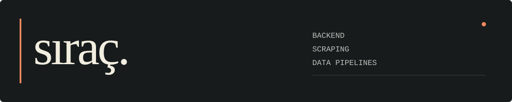
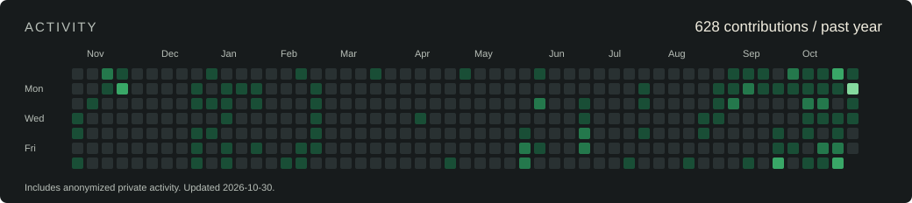

I write backends and collect data from the web. Mostly Node.js and Python.
I started with CS:GO server plugins, moved through PHP, and now spend most of my time on APIs, collectors and the data they leave behind.

### What I've been building

**Oran Analizcim**  
A football odds analysis product. Collection from 30+ sources, normalization and price history. Started with Puppeteer; moved collection to the underlying APIs as the dataset grew. The application code is private; [this small demo](https://github.com/sk-asd/odds-data-pipeline-demo) shows the normalization and snapshot logic with mock data.

**DiziFilmYorum**  
A TV and film tracking project with a web app and an Android app. Another side of my work: building the product around the data, from its API to the screens people use.

### A few things you can run

| Project | What's inside |
| :--- | :--- |
| [bershka-stock-tracker](https://github.com/sk-asd/bershka-stock-tracker) | Stock and price checks by colour and size, saved observations and optional Telegram alerts. |
| [har-endpoint-finder](https://github.com/sk-asd/har-endpoint-finder) | Read a HAR file and rank the requests that carry useful data. Python, no dependencies. |
| [scraper-reliability-kit](https://github.com/sk-asd/scraper-reliability-kit) | A deliberately unreliable local server, plus a worker with pacing, retries and source cooldowns. |
| [odds-data-pipeline-demo](https://github.com/sk-asd/odds-data-pipeline-demo) | Different input formats, one market schema, snapshots and a price change log. |
| [async-crawler](https://github.com/sk-asd/async-crawler) | A queue, bounded workers, per-host pacing and URL deduplication. |

Also: [request signatures](https://github.com/sk-asd/signed-endpoint-scraper) / [TLS fingerprints](https://github.com/sk-asd/tls-fingerprint-scraper).

Before that: game server plugins

SourcePawn was where I started writing code for other people to use. The old CS:GO projects are public now: [Corona](https://github.com/sk-asd/Corona-Oyunu), [Surf LR](https://github.com/sk-asd/Surf-LR), [HS Savaşı](https://github.com/sk-asd/HS-Savasi) and more in the repositories tab.

---

Open to backend and data collection roles. [LinkedIn](https://www.linkedin.com/in/sk-dev-tr)
